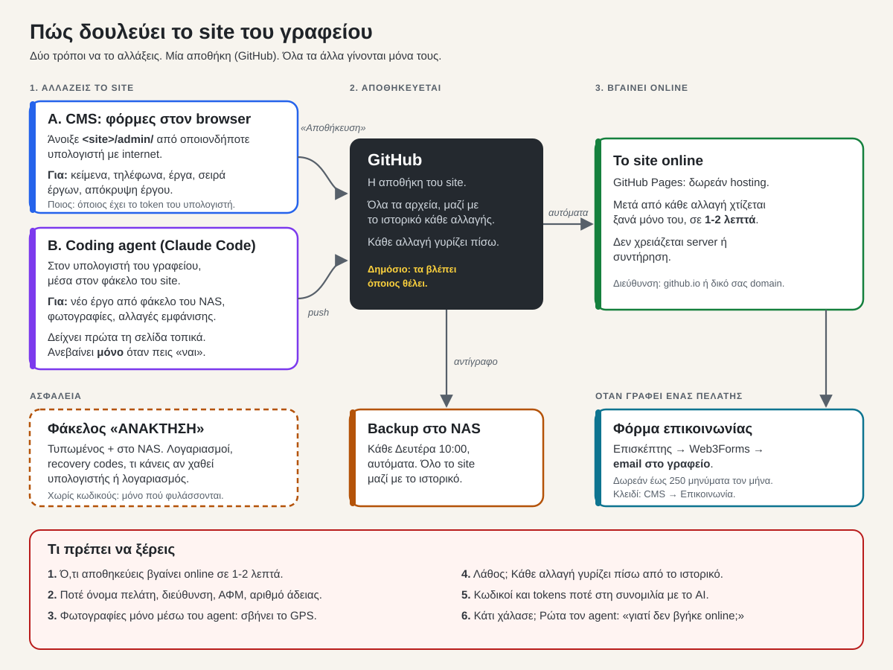

# av-website

Site του τεχνικού γραφείου Αλέξανδρου Βλάχου, πολιτικού μηχανικού στη Λευκάδα.

- **Astro 7**, στατικό. Hosting: **GitHub Pages** (δωρεάν), αυτόματα σε κάθε push στο `main`.
- **Sveltia CMS** στο `/admin/`: φόρμες για έργα και στοιχεία γραφείου, online ή τοπικά.
- Περιεχόμενο σε απλά αρχεία: `src/content/projects/<slug>.el.md` / `.en.md` και `src/data/site.json`.
- Δύο γλώσσες: ελληνικά στο `/`, αγγλικά στο `/en/`. Κείμενα εκτός CMS: `src/i18n.ts`.
- Οδηγίες για AI agent: `AGENTS.md`. Στήσιμο σε νέο υπολογιστή από το μηδέν: `SETUP.md`.

Τα έργα με `demo: true` και οι φωτογραφίες Unsplash είναι παραδείγματα.

## Πώς δουλεύει



## Αλλαγές με coding agent (Claude Code)

Για νέο έργο από το NAS, φωτογραφίες ή αλλαγές εμφάνισης. Για απλά κείμενα αρκεί το CMS (`<site>/admin/`).

1. Άνοιξε PowerShell και γράψε: `cd C:\Sites\av-website`
2. Γράψε `claude` και πάτα Enter.
3. Πες στα ελληνικά τι θέλεις. Παραδείγματα:
   - «Πρόσθεσε νέο έργο από τον φάκελο `\\NAS\Έργα\Βίλα Νικιάνα`»
   - «Άλλαξε το τηλέφωνο σε …»
   - «Κρύψε το έργο Δράγανο»
   - «Γύρνα πίσω την τελευταία αλλαγή»
   - «Μετάφρασε στα αγγλικά ό,τι άλλαξε»
4. Ο agent διαβάζει μόνος του τους κανόνες (`AGENTS.md`) και φέρνει πρώτα ό,τι άλλαξε από το CMS.
5. Σου δείχνει τη σελίδα στο `http://localhost:4321/`. Αν είναι σωστή, πες «ναι». Βγαίνει online σε 1-2 λεπτά.

Αν ο agent ζητήσει κωδικό ή token, **μην** τον γράψεις στη συνομιλία.

## Γρήγορα

```bash
npm ci
npm run dev        # http://localhost:4321/   CMS: /admin/index.html
npm run build      # ελέγχει το περιεχόμενο και φτιάχνει το dist/
```

## Αρχεία

| Αρχείο | Τι κάνει |
|---|---|
| `src/components/Home.astro` | Αρχική, σε μία γλώσσα. Περνάει τα δεδομένα στο `public/app.js`. Σελίδες: `src/pages/index.astro`, `src/pages/en/index.astro` |
| `src/components/ProjectPage.astro` | Μία σελίδα ανά έργο: `/erga/<id>/` και `/en/projects/<id>/` |
| `src/i18n.ts` | Κείμενα της σελίδας εκτός CMS, σε `el` και `en` |
| `src/lib/projects.ts` | Ενώνει `<slug>.el.md` με `<slug>.en.md` |
| `src/content.config.ts` | Κανόνες για τα πεδία των έργων (έλεγχος στο build) |
| `public/admin/config.yml` | Φόρμες του CMS (ίδια πεδία με το παραπάνω) |
| `public/styles.css`, `public/app.js`, `public/hero3d.js` | Εμφάνιση, φίλτρα/παράθυρο έργου, 3D |
| `scripts/import-project.mjs` | Φωτογραφίες από φάκελο → WebP χωρίς EXIF/GPS |
| `scripts/backup.mjs` | `git bundle` σε φάκελο backup |
| `.github/workflows/deploy.yml` | Build + δημοσίευση στο GitHub Pages |
| `src/lib/url.ts` | Σωστά links είτε σε `/` είτε σε `/av-website/` |

Design: `DESIGN.md`.
